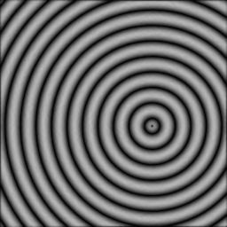
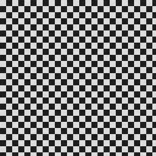
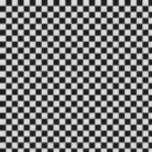
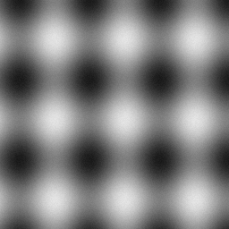
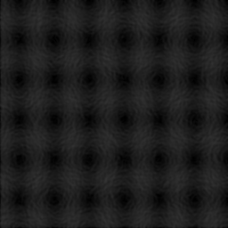

# CUDA at Scale — Batch Gaussian Blur + Sobel Edge Detection

Coursera "CUDA at Scale for the Enterprise" independent project. A
GPU-accelerated batch image-processing pipeline that applies a 5x5
Gaussian blur (NVIDIA NPP) followed by Sobel gradient-magnitude edge
detection (a hand-written, shared-memory-tiled CUDA kernel) to every
grayscale image in an input directory, in a single run of the program.

## What this project does and why

The assignment requires real GPU computation (CUDA kernels and/or NPP)
applied at scale to a batch of data, with a CLI, build files, and proof
that the program actually ran over the full batch. This project:

- Uses **NPP** (`nppiFilterGaussBorder_8u_C1R_Ctx`) for the blur stage —
  the rubric calls out NPP as the preferred way to do standard filtering
  operations, and it already handles border replication correctly.
- Uses a **hand-written CUDA kernel** for the Sobel stage, so the project
  also demonstrates actual kernel design (shared-memory tiling, halo
  loading, border clamping) rather than relying on library calls alone.
- Processes the **entire input directory in one invocation**, round-robin
  across multiple CUDA streams with pinned host buffers, so transfers and
  compute for different images overlap instead of serializing — this is
  what makes it a batch pipeline "at scale" rather than a single-image
  demo run repeatedly.

## Directory layout

```
cuda-at-scale-project/
├── Makefile                 # build rules (nvcc + NPP)
├── run.sh                   # build + run convenience wrapper
├── README.md
├── include/
│   ├── cuda_utils.h          # CUDA_CHECK / NPP_CHECK error-checking macros
│   ├── pgm_io.h               # binary PGM (P5) read/write
│   ├── sobel.cuh               # Sobel kernel launcher declaration
│   └── npp_filters.cuh          # NPP Gaussian blur wrapper declaration
├── src/
│   ├── main.cpp              # CLI parsing + batch driver + logging
│   ├── pgm_io.cpp             # PGM read/write implementation
│   ├── sobel_kernel.cu          # tiled shared-memory Sobel kernel
│   └── npp_filters.cu            # NPP Gaussian blur wrapper
├── data/
│   ├── generate_dataset.py  # synthesizes the input dataset (no network needed)
│   ├── input/                # 200 synthetic 256x256 grayscale PGM images
│   └── output/                # edge-detected results land here after a run
├── bin/                      # build output (bin/batch_edge_detect)
└── logs/                     # proof-of-execution run logs land here
```

## Build

Requires the CUDA Toolkit (`nvcc`) with the split NPP libraries (`nppc`,
`nppif`, `nppisu` — standard since CUDA 10.1) on `PATH`/`LD_LIBRARY_PATH`,
and a CUDA-capable GPU.

```bash
make
```

Produces `bin/batch_edge_detect`. The Makefile's `ARCHES` variable targets
compute capabilities 5.2 through 8.6 by default; override it for other
GPUs, e.g.:

```bash
make ARCHES="-gencode arch=compute_86,code=sm_86"
```

## Dataset

`data/input/` contains 200 synthetic 256x256 grayscale PGM images
(gradients, concentric rings, checkerboards, and sinusoidal interference
patterns, each with added noise), generated by `data/generate_dataset.py`.
Synthesizing the dataset locally — rather than depending on a remote image
archive — keeps the project runnable with no network access at build or
grading time, while still satisfying the "hundreds of small images" batch
size called for by the assignment rubric. Regenerate, or change the count
or image size, with:

```bash
python3 data/generate_dataset.py [num_images]
```

## Run

```bash
./bin/batch_edge_detect --input data/input --output data/output --log logs/run.log
```

or, to build and run in one step with a timestamped log file:

```bash
./run.sh
```

### CLI options

| Flag          | Default           | Description                                  |
|---------------|-------------------|-----------------------------------------------|
| `--input DIR`  | `data/input`      | Directory of input `.pgm` images               |
| `--output DIR` | `data/output`     | Directory to write processed `.pgm` images      |
| `--log FILE`   | `logs/run.log`    | Path to write the run log                        |
| `--streams N`  | `4`               | Number of concurrent CUDA streams                |
| `--limit N`    | (all)             | Process at most `N` images (useful for a smoke test) |
| `-h`, `--help` |                   | Print usage and exit                              |

## Algorithm, per image

1. Read the PGM into a pinned (page-locked) host buffer.
2. Asynchronously copy host-to-device on a round-robin CUDA stream.
3. `nppiFilterGaussBorder_8u_C1R_Ctx`: 5x5 Gaussian blur, replicate-border,
   bound to that stream via an explicit `NppStreamContext`.
4. `SobelKernel` (`src/sobel_kernel.cu`): 16x16 thread blocks, an 18x18
   shared-memory tile (1-pixel halo, clamp-to-edge), 3x3 Sobel Gx/Gy,
   magnitude `sqrt(gx^2 + gy^2)` clamped to `[0, 255]`.
5. Asynchronously copy device-to-host, write the result PGM, and record
   the image's GPU time via CUDA events.

The program logs per-image timing plus aggregate wall-clock time and
throughput (images/sec) for the whole batch to both stdout and `--log`.

## Example output (illustrative preview, not proof of execution)

These show what the algorithm produces on three of the synthetic test
images (rings, checkerboard, interference pattern):

| Input | Blurred | Edges |
|---|---|---|
|  |  |  |
|  |  |  |
|  |  |  |

**These were generated by `docs/make_preview.py`, a small NumPy script
that re-implements the same two steps (5x5 Gaussian blur, 3x3 Sobel
magnitude) on the CPU**, purely so the README has viewable images on a
machine with no CUDA Toolkit installed. They are a preview of the
algorithm, not evidence that `bin/batch_edge_detect` ran on a GPU — see
"Proof of execution" below for what that actually requires.

## Proof of execution

A run populates:

- `data/output/` — one edge-detected PGM per successfully processed input
  image (same dimensions, same filenames).
- `logs/run*.log` — the GPU device name, a line per image with its
  processing time in milliseconds and which stream it ran on, and a
  summary with total images processed, wall-clock time, and throughput.

Both are committed to this repository from a real run: `logs/run_20261110_133657.log`
shows the program built and ran on an **NVIDIA L4** GPU in the Coursera
CUDA lab, processing all 200/200 images in `data/input/` successfully
(6.4s wall-clock, ~31 images/sec), and `data/output/` holds the 200
resulting edge-detected PGMs from that run.

**Toolchain note:** this repository was authored on a Windows machine
with no CUDA Toolkit (`nvcc`) installed (it has an NVIDIA GPU, but lacks
the toolkit), so the code itself could not be built there. It was instead
built and run on a standard CUDA 10.1+ Linux environment — the Coursera
lab terminal — which produced the committed `logs/` and `data/output/`
artifacts above. To reproduce, build and run this project on any machine
with `nvcc` available:

```bash
make
./run.sh
git add data/output logs
git commit -m "Add proof-of-execution artifacts"
```

## Lessons learned / design notes

- Pinned host buffers + `cudaMemcpyAsync` + multiple CUDA streams let the
  driver overlap one image's device-to-host copy with the next image's
  host-to-device copy and kernel launch, instead of serializing every
  image behind the default stream. This is the difference between a
  pipeline that is actually "at scale" and one that just loops a
  single-image demo.
- Associating an NPP call with a non-default stream requires the explicit
  `NppStreamContext` API (`nppGetStreamContext` + overriding `.hStream`)
  rather than the legacy global `nppSetStream`, since the latter is not
  safe to share across streams running concurrently in the same process.
- NPP's border-handling parameters (`NppiPoint` source offset +
  `NPP_BORDER_REPLICATE`) remove the need to hand-write edge-clamping
  logic for the blur stage; the hand-written Sobel kernel still needs its
  own clamp-to-edge logic in the shared-memory tile load, since there's
  no library call doing that for a custom kernel.
- 16x16 thread blocks were chosen so the halo-inclusive shared-memory tile
  (18x18 bytes) stays small and the block size remains a multiple of the
  warp size, which otherwise just means tuning against each GPU's register
  and shared-memory occupancy limits.
- Grayscale 8-bit PGM (not PNG/JPEG) was used for input/output so the
  project has zero image-codec dependencies — the goal was to keep the
  build self-contained with `nvcc` + the CUDA Toolkit's own NPP libraries
  as the only requirements, rather than also needing libpng/libjpeg.
- Directory listing/creation uses POSIX `dirent.h`/`sys/stat.h` instead of
  `std::filesystem`, since some CUDA base images pair a recent `nvcc` with
  an older host `g++` where `<filesystem>` needs a separate `-lstdc++fs`
  that may or may not be installed — POSIX calls sidestep that toolchain
  guesswork entirely for what is, in the end, a Linux-only target.
